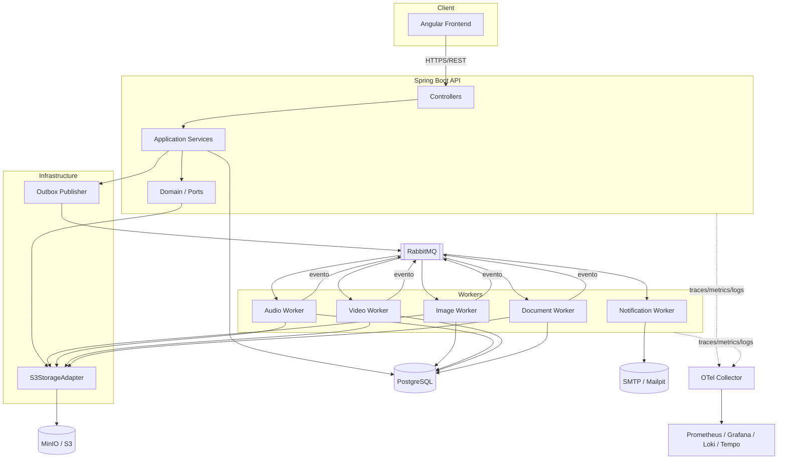
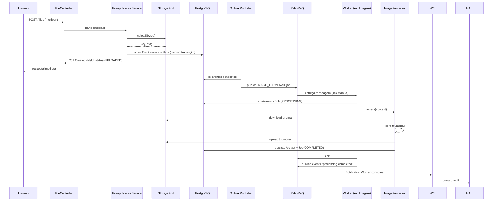
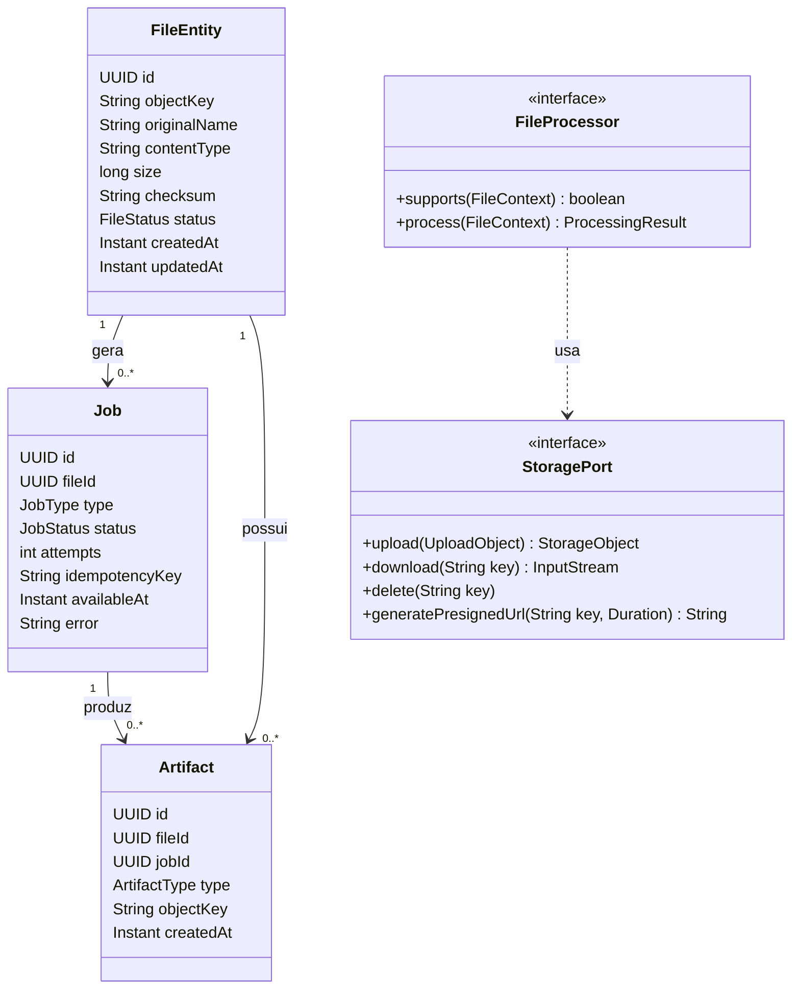
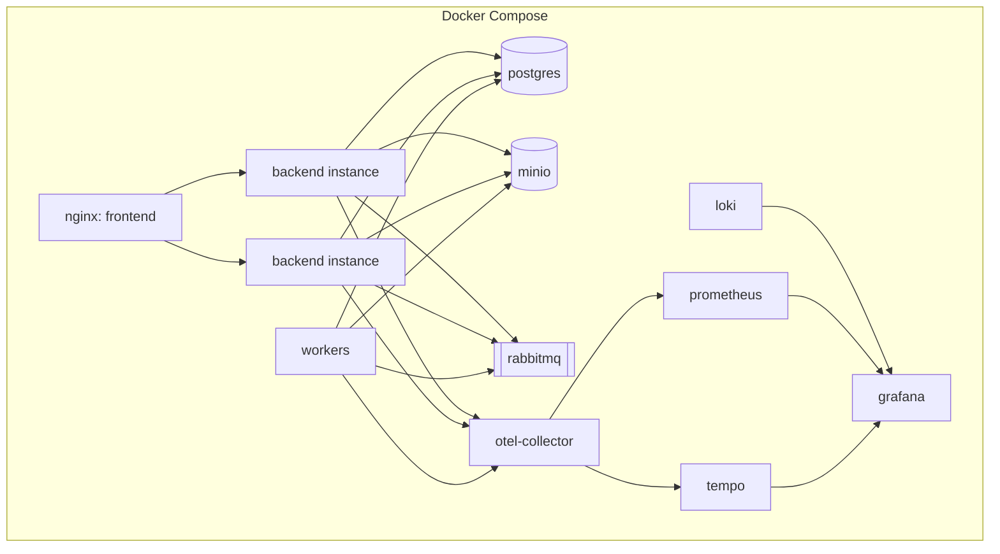
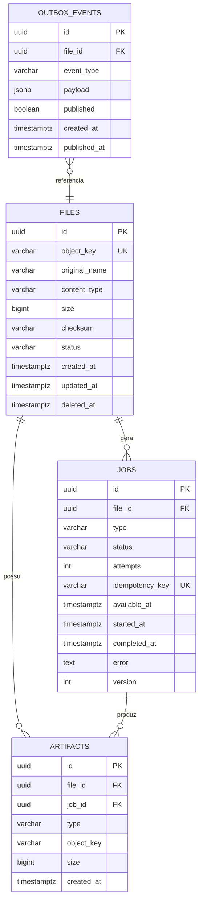
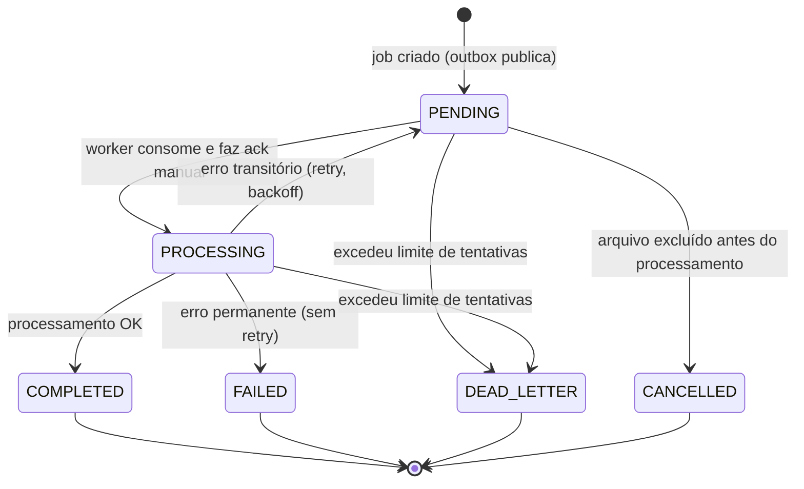
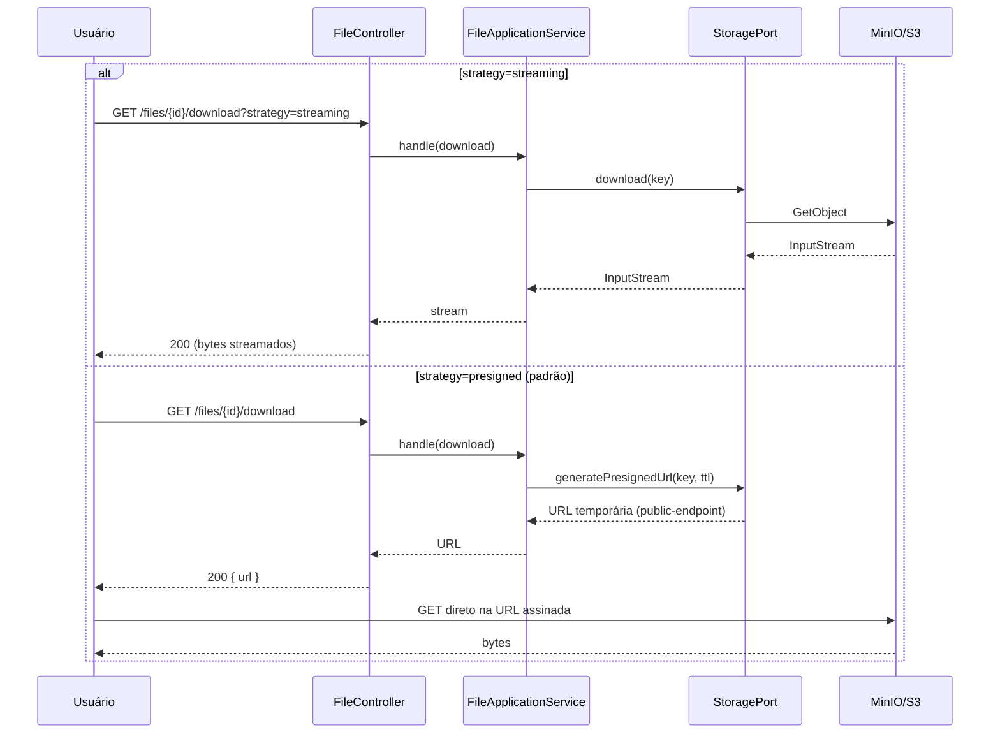
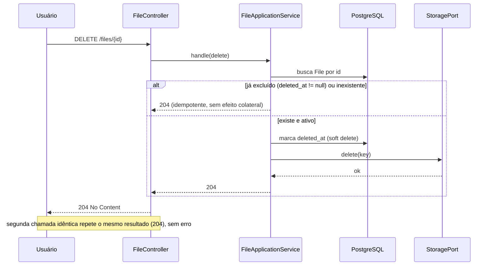
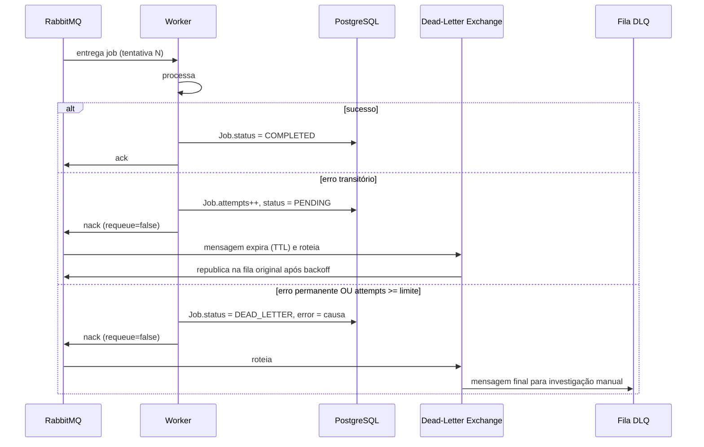
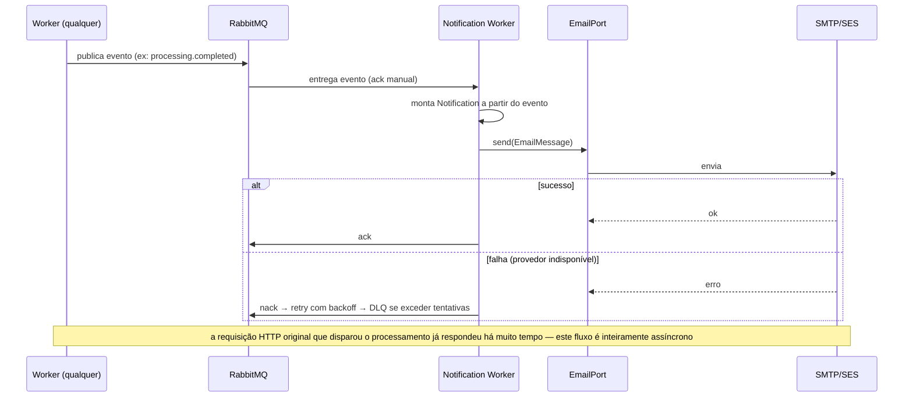

# FileFlow — Distributed File Processing Platform
## System Design

---

## 1. Problema

Sistemas de gerenciamento de arquivos costumam ser tratados como um CRUD simples sobre um bucket de storage. Isso funciona até o momento em que o arquivo precisa de **processamento** — gerar thumbnail, transcrever áudio, extrair texto de um PDF — e a aplicação acopla essa lógica pesada diretamente à requisição HTTP de upload, bloqueando o cliente e tornando o sistema frágil a qualquer falha do processador.

O FileFlow resolve isso tratando upload e processamento como **etapas desacopladas**: o upload apenas registra e armazena o arquivo; o processamento é assíncrono, extensível por tipo de arquivo, e resiliente a falhas transitórias e permanentes.

## 2. Objetivos

- Ingestão seguro de arquivos de qualquer tipo, com metadados confiáveis.
- Processamento assíncrono especializado por família de arquivo (imagem, áudio, vídeo, documento), sem acoplar o núcleo da aplicação a implementações concretas.
- Rastreabilidade total do ciclo de vida de um arquivo e dos artefatos que ele gera.
- Resiliência a falhas de storage, fila, processadores e e-mail, sem perda de estado.
- Portabilidade entre MinIO (local) e Amazon S3 (produção) via troca de configuração, não de código.
- Observabilidade desde o primeiro dia (métricas, logs estruturados, tracing distribuído).
- Extensibilidade: adicionar um novo tipo de processador não deve exigir alterar o núcleo do domínio.

## 3. Requisitos funcionais

| # | Requisito |
|---|---|
| RF01 | Upload de arquivo via multipart, com validação de tamanho e MIME type |
| RF02 | Listagem paginada com filtros (tipo, tamanho, data, status) |
| RF03 | Consulta de metadados e status de um arquivo específico |
| RF04 | Download via streaming ou presigned URL |
| RF05 | Exclusão idempotente de arquivo |
| RF06 | Processamento assíncrono acionado após o upload, quando aplicável |
| RF07 | Acompanhamento de status de job (`PENDING`, `PROCESSING`, `COMPLETED`, `FAILED`, `DEAD_LETTER`) |
| RF08 | Geração e persistência de artefatos derivados (thumbnail, transcrição, metadados extraídos) |
| RF09 | Consulta de artefatos associados a um arquivo original |
| RF10 | Notificação por e-mail em eventos relevantes (upload concluído, processamento concluído/falho, exclusão) |
| RF11 | Documentação interativa via Swagger/OpenAPI |

## 4. Requisitos não funcionais

| # | Requisito |
|---|---|
| RNF01 | Upload não pode bloquear na espera do processamento pesado |
| RNF02 | Operações críticas (upload, delete, jobs, e-mail) devem ser idempotentes |
| RNF03 | O sistema deve tolerar múltiplas instâncias do backend e múltiplos workers concorrentes |
| RNF04 | Falha em um processador não pode afetar a disponibilidade da API |
| RNF05 | Troca de MinIO → S3 deve ser possível apenas com configuração |
| RNF06 | Logs nunca devem conter credenciais, tokens ou conteúdo de arquivo |
| RNF07 | Métricas não devem usar labels de alta cardinalidade (`fileId`, `userId`, `requestId`) |
| RNF08 | O sistema deve se recuperar de reinício sem perda de jobs pendentes |
| RNF09 | Build deve falhar diante de violação de Checkstyle configurada como bloqueante |

## 5. Decisões arquiteturais e trade-offs

### 5.1 Modular monolith vs microservices

**Decisão:** modular monolith com fronteiras de módulo (`files`, `storage`, `processing`, `messaging`, `notification`) e portas/adapters bem definidos.

Microservices trariam deploy e escalabilidade independentes por worker, mas custam complexidade operacional (service discovery, tracing entre serviços, deploy separado) desnecessária para o estágio atual do projeto. Como os módulos já se comunicam por portas e não por chamadas diretas de classe concreta, a extração futura de um worker para um serviço próprio é uma mudança de infraestrutura, não de domínio.

### 5.2 Spring MVC vs WebFlux

**Decisão:** Spring MVC.

WebFlux compensa em cenários de I/O massivamente concorrente com baixo custo de thread (ex.: proxies, gateways). Aqui, a maior parte do trabalho pesado (processamento de arquivo) já é delegada a workers assíncronos via fila — a API em si faz operações de I/O relativamente curtas (persistir metadado, publicar mensagem). Adotar WebFlux aqui pagaria o custo de programação reativa (código mais complexo, stack trace pior, testes mais difíceis) sem ganho real, já que o gargalo não está na API HTTP.

### 5.3 Streaming vs Presigned URL para download

**Decisão:** oferecer as duas estratégias, com presigned URL como padrão.

- **Streaming**: o backend intermedeia todo o fluxo de bytes. Simples de proteger com autorização por requisição, mas consome memória/threads do backend proporcionalmente ao tráfego de download, e duplica o custo de rede (storage → backend → cliente).
- **Presigned URL**: o backend apenas autoriza e devolve uma URL temporária; o cliente baixa direto do storage. Escala melhor e reduz custo do backend, mas exige que o endpoint do storage seja alcançável pelo cliente — problema real em Docker, onde o hostname `minio` resolve entre containers mas não no navegador do usuário. A solução usa um **endpoint público configurável** (`storage.public-endpoint`) diferente do endpoint interno usado pelo backend para assinar a URL, resolvendo a divergência de hostname sem expor a rede interna.

Streaming fica disponível como fallback para casos que exigem controle fino por requisição (ex.: auditoria linha a linha) ou storages sem suporte a presigned URL.

### 5.4 Metadados no storage vs PostgreSQL

**Decisão:** PostgreSQL desde o início.

Manter metadados só no S3/MinIO (via object metadata/tags) evita um banco, mas quebra rapidamente diante de RF02 (listagem com filtros e paginação arbitrária) — o S3 não foi desenhado para queries relacionais, e paginação por `continuation-token` não suporta filtro por múltiplos campos combinados de forma eficiente. Um banco relacional também é necessário para persistir o estado dos jobs (RF07) de forma consultável e para constraints de idempotência (unique constraint em `idempotency_key`).

### 5.5 Fila: RabbitMQ vs Redis Streams vs Kafka

**Decisão:** RabbitMQ.

- **Kafka** é otimizado para throughput altíssimo e replay de eventos históricos — excede a necessidade deste domínio (jobs de processamento não precisam ser "replayados" como um log de eventos de negócio) e tem custo operacional maior.
- **Redis Streams** é leve, mas o modelo de consumer groups e DLQ é mais manual de implementar corretamente, e a persistência depende de configuração de durabilidade do Redis, que não é seu caso de uso primário.
- **RabbitMQ** oferece nativamente ack/nack, retry com backoff (via TTL + DLX), dead-letter exchange e consumidores concorrentes com prefetch configurável — exatamente o conjunto de primitivas que os requisitos de retry/DLQ (seção 15 do spec original) pedem, com curva de configuração menor.

### 5.6 AWS SDK retry nativo vs Spring Retry/Resilience4j

**Decisão:** usar o retry nativo do AWS SDK v2 para chamadas a S3/MinIO (já cobre erros transitórios de rede com backoff exponencial configurável), e Resilience4j apenas para orquestrar retry de **jobs de processamento** (camada de aplicação, não de infraestrutura), evitando duplicar política de retry na mesma chamada.

### 5.7 Circuit Breaker

**Decisão:** não adotado na primeira versão.

Circuit breaker se justifica quando uma dependência instável pode ser sistematicamente evitada por um período (ex.: um serviço externo de transcrição de terceiros). Neste estágio, os workers já lidam com falha via retry + DLQ, e o storage é uma dependência essencial sem fallback razoável (não há "modo degradado" sem storage). Adicionar circuit breaker aqui seria complexidade sem redução de risco real. Fica documentado como candidato natural caso um provedor de transcrição externo seja introduzido no lugar da implementação local.

### 5.8 Promtail/Loki vs logs via OpenTelemetry

**Decisão:** Promtail + Loki para logs, OTel para métricas e traces.

O OTel Logs ainda é a parte menos madura do padrão OpenTelemetry. Promtail + Loki é uma combinação estável, leve, e que já lê logs estruturados em stdout sem exigir instrumentação adicional no código — o correlation entre log e trace é obtido incluindo `trace_id`/`span_id` no log estruturado (via MDC do Logback), não pelo pipeline de export.

### 5.9 Maven vs Gradle

**Decisão:** Maven — convenção mais rígida, menos necessidade de scripts customizados para este escopo, e integração direta com Checkstyle/JaCoCo/OWASP Dependency Check via plugins padrão.

### 5.10 Thumbnail síncrono vs assíncrono

**Decisão:** sempre assíncrono via fila, mesmo para imagens pequenas. Manter uma exceção (processamento síncrono só para imagens abaixo de X KB) introduziria dois caminhos de código para o mesmo resultado, complicando observabilidade e testes, para um ganho de latência que o frontend já absorve mostrando estado `PROCESSING`.

### 5.11 Consistência: transação de banco vs S3

**Decisão:** não existe transação distribuída entre PostgreSQL, S3/MinIO, fila e e-mail. O sistema assume consistência eventual e usa o padrão **outbox**: a gravação do registro do arquivo e o evento "arquivo armazenado" são persistidos na mesma transação do PostgreSQL; um publisher assíncrono lê a tabela outbox e publica na fila, com retry até confirmação. Isso evita o cenário clássico de "salvei no S3 mas o banco caiu antes de persistir o metadado" ou "publiquei na fila mas a transação do banco fez rollback".

## 6. Arquitetura de alto nível



## 7. Componentes

| Componente | Responsabilidade |
|---|---|
| `files` | Ciclo de vida do arquivo: upload, consulta, listagem, exclusão |
| `storage` | Abstração de storage (`StoragePort`) e adapter concreto S3/MinIO |
| `processing` | Definição de job, seleção de processador (`FileProcessor`), execução |
| `messaging` | Publicação/consumo de jobs, outbox, retry, DLQ |
| `notification` | Eventos de domínio → notificações, `EmailPort` |
| `observability` | Configuração de OTel, métricas customizadas |
| `health` | Liveness/readiness |

## 8. Storage

Porta única (`StoragePort`) implementada por um adapter que usa exclusivamente AWS SDK v2 (`S3Client`, `S3Presigner`), válido tanto para MinIO (`force-path-style: true`) quanto S3 real. Nenhuma classe de domínio importa o SDK — apenas a implementação de infraestrutura.

Key do objeto: `objects/{uuid}.{extensao}` — nunca o nome original, evitando path traversal e colisão. `originalName`, `contentType` e `extension` ficam no banco, não no path.

Inicialização do bucket é idempotente: em caso de corrida entre instâncias (`BucketAlreadyOwnedByYouException` ou equivalente), a exceção é tratada como sucesso, não como erro fatal.

## 9. API

```
POST   /files                  → upload
GET    /files                  → listagem paginada com filtros
GET    /files/{id}             → metadados
GET    /files/{id}/download    → streaming ou presigned (query param ?strategy=)
DELETE /files/{id}             → exclusão idempotente
GET    /files/{id}/thumbnail   → atalho para artefato de thumbnail
GET    /files/{id}/artifacts   → lista de artefatos derivados
GET    /files/{id}/jobs        → status dos jobs de processamento
```

Contratos via DTO/records; entidades de domínio nunca são serializadas diretamente. Erros mapeados via `@RestControllerAdvice` para os status HTTP definidos na seção 20 do documento de requisitos original.

## 10. Concorrência

| Cenário | Mecanismo | Motivo |
|---|---|---|
| Duplo processamento do mesmo job (redelivery) | `idempotency_key` com unique constraint na tabela de jobs | Redelivery é esperado em filas com ack manual; a constraint rejeita a segunda tentativa de criar o mesmo job sem lock explícito |
| Duas instâncias criando o bucket ao mesmo tempo | Tratamento idempotente da exceção "bucket já existe" | Mais simples que um lock distribuído para uma operação que já é naturalmente idempotente no S3 |
| Duas requisições de exclusão do mesmo arquivo | Delete idempotente (segunda chamada retorna 204/404 tratado, não erro) | Evita que o cliente precise coordenar chamadas concorrentes |
| Múltiplos workers do mesmo tipo | Prefetch count limitado no consumer RabbitMQ + ack manual após conclusão | Garante que uma mensagem só é considerada processada após sucesso real, sem exigir lock em nível de aplicação |

Optimistic locking (`@Version`) é usado apenas na entidade `Job`, cujo estado é atualizado por múltiplos workers/consumers potencialmente ao mesmo tempo (ex.: watchdog de timeout vs worker concluindo).

## 11. Fila persistente

RabbitMQ com exchange principal, uma fila por tipo de job, TTL + dead-letter-exchange para backoff, e uma fila de DLQ final para investigação manual. Consumidores concorrentes com prefetch configurável por tipo de worker.

## 12. Workers

Processo separado do `FileManagementApplication` (mesmo artefato, perfil de execução diferente), consumindo filas específicas. Falha de um worker não derruba a API nem os demais workers. Graceful shutdown: para de consumir, aguarda mensagens em processamento, e permite que mensagens não concluídas retornem à fila (sem ack) para redelivery.

## 13. Processamento assíncrono



## 14. Notificações e e-mail

`NotificationPort` e `EmailPort` desacoplam o domínio do provedor (SMTP local via Mailpit em dev, SES em produção). Envio sempre assíncrono, disparado por evento de domínio publicado na fila — a requisição HTTP nunca aguarda o envio de e-mail.

## 15. Segurança

- Autenticação/autorização via Spring Security (JWT ou sessão, a definir na fase de implementação).
- Ownership: usuário só acessa arquivos próprios (ou compartilhados, se esse escopo for adicionado depois).
- Validação de MIME type por conteúdo (magic bytes), não apenas extensão — evita spoofing.
- Limite de tamanho de upload configurável, rejeitado antes de gravar no storage.
- Presigned URLs com expiração curta e configurável.
- Nenhuma credencial em log, resposta de erro ou código-fonte.

## 16. Observabilidade

Métricas via Micrometer/Prometheus (uploads, downloads, erros, latência, profundidade de fila, tempo de processamento por tipo de job, retries, mensagens em DLQ) sem labels de alta cardinalidade. Tracing distribuído via OpenTelemetry propagado da API até o worker (trace continua através da mensagem de fila via headers). Logs estruturados (JSON) via Logback, com `trace_id`/`span_id` injetados via MDC, coletados por Promtail e centralizados no Loki.

## 17. Resiliência

Exceções de domínio específicas (`StorageUnavailableException`, `QueueUnavailableException`, etc.) mapeadas para status HTTP apropriados. Timeout configurado em toda chamada de rede (S3, fila, e-mail). Retry com backoff exponencial e classificação de erro (transitório vs permanente) antes de tentar novamente — erros permanentes (ex.: arquivo corrompido) vão direto para `FAILED`, sem consumir tentativas de retry.

## 18. Escalabilidade

API e workers são **stateless** (todo estado vive no PostgreSQL, storage e fila) — escalam horizontalmente atrás de um load balancer sem coordenação adicional. O gargalo natural de escala é o número de consumers por fila, ajustável independentemente por tipo de processador (ex.: mais workers de vídeo do que de documento, se o perfil de uso pedir).

## 19. Disponibilidade e recuperação de falhas

Readiness verifica dependências essenciais (banco, storage, fila); liveness não depende delas, evitando reinícios em cascata por indisponibilidade temporária de uma dependência externa. Jobs sobrevivem a reinício da aplicação porque vivem na fila/banco, não em memória. Após reinício, workers retomam o consumo normalmente; jobs "presos" em `PROCESSING` por tempo excessivo são detectados por um watchdog e requeued.

## 20. Consistência distribuída

Ver seção 5.11 (outbox pattern). Resumo do princípio: nenhuma operação assume atomicidade entre banco, storage, fila e e-mail — cada etapa é idempotente e o estado intermediário é sempre consultável, permitindo reconciliação manual ou automática em caso de falha parcial.

## 21. Diagrama de domínio (Class Diagram)



## 22. Diagrama de implantação (Deployment)



## 23. Diagrama de banco de dados (Entidade-Relacionamento)



Índices relevantes: `files.object_key` (unique), `jobs.idempotency_key` (unique — garante a idempotência descrita na seção 10), `jobs.status` + `jobs.available_at` (consulta do scheduler/watchdog), `artifacts.file_id` (listagem de artefatos por arquivo), `outbox_events.published` (consulta do publisher). `files.deleted_at` permite soft delete, coerente com a exclusão idempotente da seção 9.

## 24. Diagrama de estados do Job



## 25. Sequência — Download (streaming vs presigned)



## 26. Sequência — Exclusão idempotente



## 27. Sequência — Retry e Dead Letter Queue



## 28. Sequência — Notificação por e-mail



## 29. Trade-offs — resumo

| Decisão | Escolhido | Alternativa descartada | Motivo principal |
|---|---|---|---|
| Concorrência web | Spring MVC | WebFlux | Gargalo não está na API, é no processamento (já assíncrono via fila) |
| Download | Presigned URL (padrão) + streaming (fallback) | Só streaming | Escala melhor, menor custo de backend |
| Metadados | PostgreSQL | Só metadata do S3 | Queries com filtro/paginação exigem modelo relacional |
| Fila | RabbitMQ | Kafka, Redis Streams | Melhor encaixe com retry/DLQ nativos para este volume |
| Retry infra | AWS SDK nativo | Spring Retry para chamadas S3 | Evita duplicar política de retry na mesma chamada |
| Circuit breaker | Não adotado agora | Resilience4j CB | Sem dependência externa instável que justifique |
| Logs | Promtail + Loki | OTel Logs | Maturidade e simplicidade de instrumentação |
| Build | Maven | Gradle | Convenção + integração padrão com Checkstyle/JaCoCo |
| Thumbnail | Sempre assíncrono | Síncrono para arquivos pequenos | Evita dois caminhos de código para o mesmo resultado |
| Consistência | Outbox + idempotência | Transação distribuída | Não existe transação real entre banco, S3, fila e e-mail |

---

Próxima fase sugerida: **Storage abstraction + upload/download/delete básico** (sem fila ainda), seguindo a ordem definida aqui.
